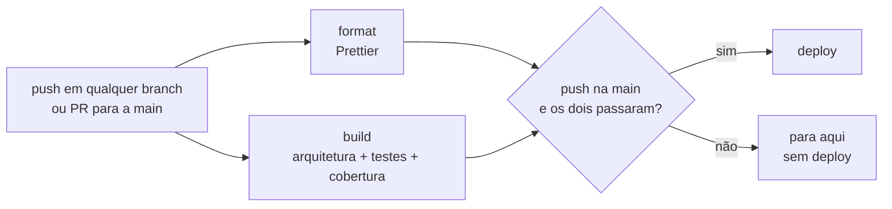
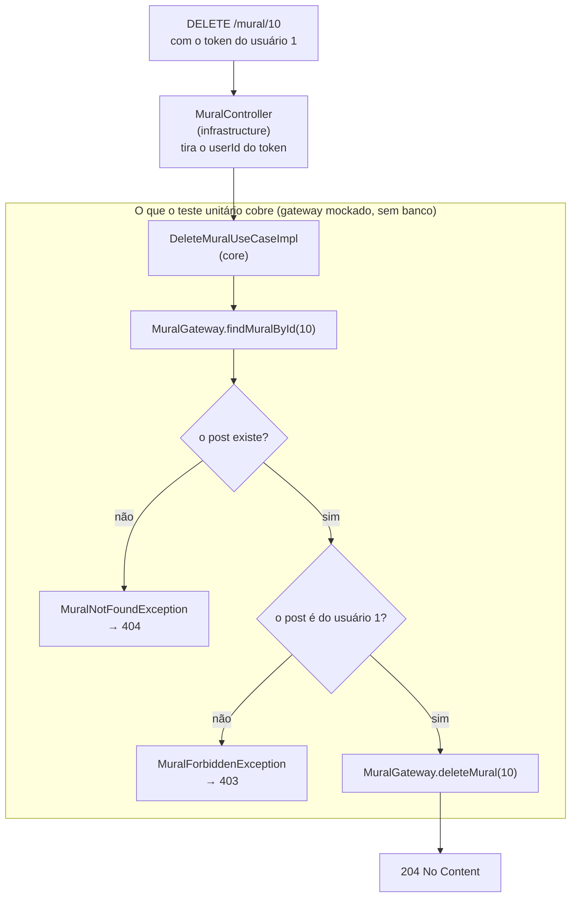
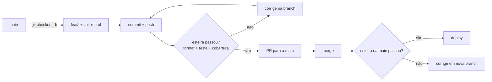

<p align="center">
  
</p>

<h1 align="center">Enveloppe</h1>

<p align="center">
  <b>Uma carta do seu eu futuro, aberta na hora em que você mais precisa dela.</b><br />
  Um objetivo com data, uma declaração lida todo dia e cartas que aparecem quando bate o impulso, a dúvida ou o medo.
</p>

https://github.com/user-attachments/assets/d2b84d01-70bc-4743-a1c4-f6fbb38cd6b9

---

## O que é

O Enveloppe é um app para quem já sabe o que quer, mas se perde no caminho.

A maioria dos apps de hábitos conta o que você fez. O Enveloppe cuida do momento antes: aquele em que dá vontade de adiar, de abrir o celular, de duvidar ou de desistir. Nessa hora, quem fala com você não é uma notificação genérica. É uma carta que **você mesmo** escreveu, no papel do seu eu futuro, a pessoa que já chegou lá.

O mascote do app é o **Envelopinho**, um envelope de papel que pisca, sorri, abre a aba e entrega a carta. Ele está em quase todas as telas, e o selo dele muda de cor conforme você avança.

## Como o Enveloppe te ajuda

- **Dá um foco só.** Você escolhe um objetivo principal, com data, o que vai dar em troca e o porquê. Ele fica no topo da tela todos os dias.
- **Faz o objetivo virar hábito de pensamento.** Uma declaração curta, lida em voz alta toda manhã, repete o objetivo até ele parecer natural.
- **Te segura no momento difícil.** Bateu impulso, dúvida ou medo? Abra a carta. O seu eu futuro responde com o que você escreveu para esse exato momento, e te dá 10 minutos de ação.
- **Organiza o dia sem complicar.** Tarefas por parte do dia (manhã, dia, noite), com repetição, duração, alarme, subtarefas e etiquetas.
- **Ajuda a focar.** Um Pomodoro com tela de foco, som de alarme e histórico de quanto você focou e em quê.
- **Mostra quem você está virando.** Revisão da noite, registro de humor, gráficos dos dias e um mural com as suas conquistas.
- **Recompensa a constância.** Selos por dias de uso e por tarefas feitas, que liberam ícones novos para o app e cores novas para o selo do Envelopinho.
- **Guarda uma promessa.** A cápsula do tempo é uma carta lacrada que nem você consegue ler até a data escolhida.

## O método

O app se apoia em 23 princípios clássicos de mudança pessoal, organizados em quatro etapas. Todos estão dentro do app, na tela **Por que escrever a carta?**, cada um com a explicação e o ponto do app em que ele aparece.

### 1. Decidir
Um único objetivo principal, com desejo de verdade e não só esperança. O objetivo tem quatro partes: **o que** você quer, **o que vai dar em troca**, **por que** quer e **até quando**. Primeiro você decide; o "como" aparece depois. Essas respostas viram a sua declaração, escrita no presente, como quem já conseguiu: *"Eu estou tão feliz e grato agora que…"*.

### 2. Mudar por dentro
Resultados vêm dos hábitos de pensamento, não só do conhecimento. E esses hábitos mudam de dois jeitos: por **repetição** ou por **impacto emocional**. O app usa os dois. A repetição está na declaração e no ensaio de todo dia. A emoção está na carta, na cápsula do tempo e no mural de conquistas.

### 3. Todo dia
- **De manhã:** ler a declaração em voz alta, ensaiar por alguns minutos como é ser o seu eu futuro (com respiração guiada) e escolher quem você quer ser hoje.
- **Durante o dia:** cumprir as tarefas e, quando o padrão antigo aparecer, interromper na hora com a carta.
- **À noite:** revisar onde você voltou ao eu antigo e o que o seu eu futuro teria feito diferente.

### 4. Persistir
Se o plano falhar, troque o plano, não o objetivo. O app mostra a sequência de dias, as missões e os selos, e ajuda a atravessar o medo em vez de recuar.

## A ideia por trás

> Você já é, por dentro, a pessoa que quer ser. O que falta é ela aparecer com mais frequência do que o eu antigo.

O Enveloppe parte de três ideias simples:

1. **O eu futuro sabe o caminho.** Ninguém melhor do que você mesmo, num dia bom e com a cabeça fria, para escrever o que o você de um dia ruim precisa ouvir.
2. **A mudança acontece nos momentos pequenos.** Não no começo de ano, mas nos dez segundos entre a vontade de adiar e a decisão de começar.
3. **Repetição com emoção muda quem você é.** Ler, ensaiar e sentir todos os dias, até o novo jeito virar o automático.

E uma regra de privacidade: **o que você escreve é só seu.** A senha nunca é guardada, só uma versão cifrada dela, e cada pessoa só consegue ver e mudar os próprios dados, com o token da própria conta.

## Um dia no app

<!-- Vídeo: a manhã (declaração, ensaio, intenção do dia) -->
<!-- Vídeo: marcando tarefas e usando o Pomodoro -->
<!-- Vídeo: abrindo a carta no impulso -->
<!-- Vídeo: revisão da noite e humor -->

| Momento | O que você faz | Onde |
|---|---|---|
| Manhã | Lê a declaração, ensaia o eu futuro e escolhe a intenção do dia | Hoje |
| Dia | Marca as tarefas, foca com o Pomodoro | Hoje, Pomodoro |
| Quando aperta | Abre a carta: impulso, dúvida ou medo | Carta |
| Noite | Revisa o dia e registra o humor | Hoje |
| Sempre | Vê o caminho, os selos, as recompensas e o mural | Perfil, Futuro |

## As telas

| Aba | O que tem |
|---|---|
| **Hoje** | O objetivo, a declaração, o ensaio, as tarefas por parte do dia, a revisão da noite e o humor |
| **Carta** | A carta do eu futuro para os momentos de impulso, dúvida e medo |
| **Futuro** | A carta para o seu eu futuro e a cápsula do tempo, com a contagem de dias para abrir |
| **Pomodoro** | Foco cronometrado, pausas e o histórico dos focos |
| **Perfil** | Dias para abrir a carta, selos, recompensas, contadores e o mural de conquistas |

## Selos e recompensas

<!-- Vídeo: tela de recompensas e troca do ícone do app -->

São duas trilhas de **14 selos** cada, que se encontram no selo **Início**:

- **Entradas no app:** de 7 a 1000 dias. Cada selo libera uma **cor do selo do Envelopinho**, de Kraft a Arco-íris, passando por Melancia, Lavanda, Girassol e Galáxia.
- **Tarefas feitas:** de 10 a 1000 tarefas. Cada selo libera um **ícone do app**, como Cafezinho, Pijama, Férias, Festa e, nas mil tarefas, o Astronauta.

O ícone Clássico e o selo Laranja já vêm liberados.

### Tecnologia

API em **Java 25** com **Spring Boot**, banco **PostgreSQL** e migrações com **Flyway**. O login usa **JWT**.

O código segue a arquitetura limpa: as regras do negócio não dependem do Spring, e a integração contínua confere isso a cada push.

- `src/main/java/com/enveloppe/core`: as regras do negócio (entidades, casos de uso e as portas de entrada e saída), sem nada do Spring
- `src/main/java/com/enveloppe/infrastructure`: o que liga as regras ao mundo (controllers, banco, segurança, DTOs e conversões)
- `src/main/resources/db/migration`: as migrações do banco
- `docs`: documentação das rotinas da API

## Testes e esteira (CI/CD)

**Regra:** tudo que está na `main` vai para deploy. Por isso nada entra na `main` sem passar pela esteira, e todo caso de uso precisa de teste unitário.

### Como a esteira funciona

O arquivo é `.github/workflows/pipiline.yaml`. Ela roda em todo push, em qualquer branch, e em todo PR para a `main`.



| Job | O que confere | Reprova quando |
|---|---|---|
| `format` | `npm run format:check` | algum `.java` está fora do padrão do Prettier |
| `build` | o core não importa Spring, jakarta nem `infrastructure` | o core depende do framework |
| `build` | `scripts/check-unit-tests.sh` | algum `*UseCaseImpl` não tem `*UseCaseImplTest` com Mockito |
| `build` | `./mvnw verify` (testes + JaCoCo) | algum teste quebra ou algum `*UseCaseImpl` tem menos de 80% das linhas cobertas |
| `deploy` | só roda em push na `main`, depois de `format` e `build` | — |

Na prática: crie uma branch a partir da `main` e faça quantos commits quiser. A esteira roda em cada push, mas só faz deploy quando o código chega na `main`.

### As três travas de teste

1. **Existe teste?** Para cada `src/main/java/.../FooUseCaseImpl.java`, precisa existir `src/test/java/.../FooUseCaseImplTest.java`, no mesmo pacote.
2. **O teste é unitário?** Esse arquivo precisa usar o Mockito (`org.mockito`): o gateway é mockado, sem banco.
3. **O teste cobre o use case?** O JaCoCo exige pelo menos **80% das linhas** de cada `*UseCaseImpl`, classe por classe. O relatório fica em `target/site/jacoco/index.html` e, na esteira, no artefato `jacoco-report` da aba Actions.

Controllers, gateways e mappers ficam fora dessas travas. Eles dependem de Spring e banco, e por enquanto só o `EnveloppeApplicationTests` (que sobe a aplicação) passa por eles.

### Anatomia de um teste unitário com Mockito

O teste unitário testa **só o use case**. O gateway, que falaria com o banco, é trocado por um **mock**: um objeto falso que devolve o que o teste mandar. Por isso ele roda em milissegundos e não precisa do Postgres.

Exemplo real, `src/test/java/com/enveloppe/core/useCases/users/updateEntry/UpdateEntryUseCaseImplTest.java`:

```java
@ExtendWith(MockitoExtension.class) // liga o Mockito neste teste
class UpdateEntryUseCaseImplTest {

    @Mock // gateway falso: não toca no banco
    private UserGateway userGateway;

    @InjectMocks // cria o use case de verdade, passando o mock no construtor
    private UpdateEntryUseCaseImpl useCase;

    @Test
    void devolveTrueQuandoAEntradaDeHojeAindaNaoFoiContada() {
        // Arrange: "quando chamarem updateEntry(1L), devolva true"
        when(userGateway.updateEntry(1L)).thenReturn(true);

        // Act + Assert: roda o use case e confere o resultado
        assertThat(useCase.execute(1L)).isTrue();

        // confere que o use case realmente chamou o gateway
        verify(userGateway).updateEntry(1L);
    }

    @Test
    void devolveFalseQuandoHojeJaFoiContado() {
        when(userGateway.updateEntry(1L)).thenReturn(false);

        assertThat(useCase.execute(1L)).isFalse();
    }
}
```

| Peça | O que faz |
|---|---|
| `@ExtendWith(MockitoExtension.class)` | Faz o Mockito criar os `@Mock` e o `@InjectMocks` antes de cada teste |
| `@Mock` | Cria o gateway falso. Sem `when(...)`, ele devolve `null`, `false` ou `0` |
| `@InjectMocks` | Cria o `*UseCaseImpl` real e passa os mocks no construtor |
| `when(...).thenReturn(...)` | Diz o que o mock devolve para aquela chamada |
| `assertThat(...)` / `assertThatThrownBy(...)` | Confere o resultado ou a exceção (AssertJ) |
| `verify(...)` / `verify(..., never())` | Confere que o gateway foi (ou não foi) chamado |

Todo teste segue **Arrange** (prepara o mock), **Act** (chama `execute`) e **Assert** (confere resultado e chamadas). Escreva um `@Test` para cada caminho do use case: sucesso, cada erro e cada `if`. O nome do método diz o comportamento, porque é ele que aparece quando a esteira falha.

### Exemplo completo: feature "Excluir post do mural"

Feature fictícia, para mostrar o caminho do começo ao fim. A regra de negócio: **só o dono do post pode excluí-lo**. Se o post não existe, é erro. Se existe mas é de outra pessoa, também.

O código abaixo é só ilustrativo, não existe no projeto. O que importa é o fluxo.

**O mapa da requisição:** por onde o `DELETE /mural/{id}` passa e os três caminhos possíveis do use case.



Cada saída do use case (`404`, `403` e exclusão) é um `@Test`. O controller e o banco ficam fora do teste unitário: o gateway é um mock.

**O mapa do código até o deploy:** da branch nova até a `main`.



**1. Criar a branch a partir da `main`**

```bash
git checkout main && git pull
git checkout -b feat/excluir-mural
```

**2. Contrato no core: o gateway**

```java
// src/main/java/com/enveloppe/core/gateway/users/mural/MuralGateway.java
public interface MuralGateway {
    Mural createMural(Mural mural);

    Optional<Mural> findMuralById(Long id); // novo

    void deleteMural(Long id); // novo
}
```

**3. Exceções do core** (Java puro, para o core continuar limpo)

```java
// src/main/java/com/enveloppe/core/exceptions/MuralNotFoundException.java
public class MuralNotFoundException extends RuntimeException {
    public MuralNotFoundException(Long id) {
        super("Post do mural " + id + " não encontrado");
    }
}

// src/main/java/com/enveloppe/core/exceptions/MuralForbiddenException.java
public class MuralForbiddenException extends RuntimeException {
    public MuralForbiddenException() {
        super("Só o dono pode excluir este post");
    }
}
```

**4. O use case**

```java
// src/main/java/com/enveloppe/core/useCases/users/mural/delete/DeleteMuralUseCase.java
public interface DeleteMuralUseCase {
    void execute(Long muralId, Long userId);
}

// src/main/java/com/enveloppe/core/useCases/users/mural/delete/DeleteMuralUseCaseImpl.java
public class DeleteMuralUseCaseImpl implements DeleteMuralUseCase {

    private final MuralGateway muralGateway;

    public DeleteMuralUseCaseImpl(MuralGateway muralGateway) {
        this.muralGateway = muralGateway;
    }

    @Override
    public void execute(Long muralId, Long userId) {
        Mural mural = muralGateway
            .findMuralById(muralId)
            .orElseThrow(() -> new MuralNotFoundException(muralId)); // caminho 1: não existe

        if (!mural.userId().equals(userId)) {
            throw new MuralForbiddenException(); // caminho 2: é de outra pessoa
        }

        muralGateway.deleteMural(muralId); // caminho 3: exclui
    }
}
```

O use case tem **três caminhos**, então o teste tem três `@Test`.

**5. O teste** (sem ele, a esteira reprova)

```java
// src/test/java/com/enveloppe/core/useCases/users/mural/delete/DeleteMuralUseCaseImplTest.java
@ExtendWith(MockitoExtension.class)
class DeleteMuralUseCaseImplTest {

    @Mock
    private MuralGateway muralGateway;

    @InjectMocks
    private DeleteMuralUseCaseImpl useCase;

    private Mural postDoUsuario(Long userId) {
        return new Mural(10L, userId, "Meia maratona", MuralType.SAUDE, null,
            LocalDateTime.of(2026, 10, 19, 8, 30), null, null);
    }

    @Test
    void excluiQuandoOPostEDoUsuario() {
        when(muralGateway.findMuralById(10L)).thenReturn(Optional.of(postDoUsuario(1L)));

        useCase.execute(10L, 1L);

        verify(muralGateway).deleteMural(10L);
    }

    @Test
    void lancaNotFoundQuandoOPostNaoExiste() {
        when(muralGateway.findMuralById(10L)).thenReturn(Optional.empty());

        assertThatThrownBy(() -> useCase.execute(10L, 1L))
            .isInstanceOf(MuralNotFoundException.class);

        verify(muralGateway, never()).deleteMural(any());
    }

    @Test
    void lancaForbiddenQuandoOPostEDeOutroUsuario() {
        when(muralGateway.findMuralById(10L)).thenReturn(Optional.of(postDoUsuario(2L)));

        assertThatThrownBy(() -> useCase.execute(10L, 1L))
            .isInstanceOf(MuralForbiddenException.class);

        verify(muralGateway, never()).deleteMural(any());
    }
}
```

O `verify(..., never())` garante a regra de segurança: nos dois caminhos de erro, **nada foi apagado**. Com os três testes, o JaCoCo mede 100% das linhas do `DeleteMuralUseCaseImpl`.

**6. Ligar na infraestrutura**

- `MuralRepositoryGateway`: implementa `findMuralById` (`muralRepository.findById` + mapper) e `deleteMural` (`muralRepository.deleteById`).
- `BeanConfiguration`: um `@Bean` que devolve `new DeleteMuralUseCaseImpl(muralGateway)`.
- `MuralController`: um `@DeleteMapping("/{id}")` que pega o `userId` do token e chama o use case.
- `ApplicationControllerAdvice`: `MuralNotFoundException` vira 404 e `MuralForbiddenException` vira 403.

**7. Conferir e subir**

```bash
npm run format                      # formata com o Prettier
bash scripts/check-unit-tests.sh    # todo use case tem teste com Mockito?
./mvnw verify                       # testes + cobertura (precisa do Postgres do docker-compose)
git add -A && git commit -m "feat: excluir post do mural"
git push -u origin feat/excluir-mural
```

No push da branch, a esteira roda `format` e `build`, mas **não faz deploy**. Depois, abra o PR para a `main`. Quando o merge entrar, a esteira roda de novo e, se tudo passar, faz o deploy.

### Quando a esteira reprova

| O que aparece no log | Por quê | Como resolver |
|---|---|---|
| `❌ Sem teste: .../DeleteMuralUseCaseImpl.java` | Falta o arquivo de teste | Crie o `DeleteMuralUseCaseImplTest.java` no caminho que o log mostra |
| `❌ Teste sem Mockito: ...Test.java` | O teste existe, mas não mocka o gateway | Use `@ExtendWith(MockitoExtension.class)` e `@Mock` |
| `Tests run: 3, Failures: 1` | Um teste quebrou | O log mostra o nome do método e o valor esperado contra o recebido |
| `Rule violated for class ...DeleteMuralUseCaseImpl: lines covered ratio is 0.60, but expected minimum is 0.80` | Algum caminho do use case não foi testado | Abra o relatório do JaCoCo, veja as linhas vermelhas e escreva o `@Test` que passa por elas |
| `[warn] Code style issues found` | Código fora do padrão do Prettier | Rode `npm run format` e faça o commit |
| `O core não pode importar Spring, jakarta ou infrastructure` | O core importou algo do framework | Mova essa dependência para `infrastructure` |

### Rodando na sua máquina

Uma vez só, instale o Prettier:

```bash
npm install
```

Antes de cada push:

- [ ] `npm run format` (ou `npm run format:check` para só conferir)
- [ ] `bash scripts/check-unit-tests.sh`
- [ ] `./mvnw verify`, com o Postgres do `docker-compose` rodando

